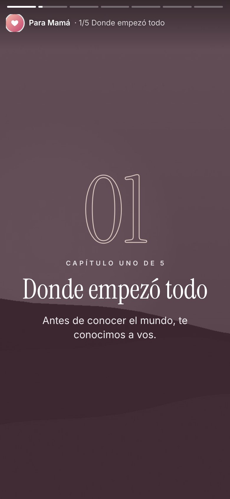
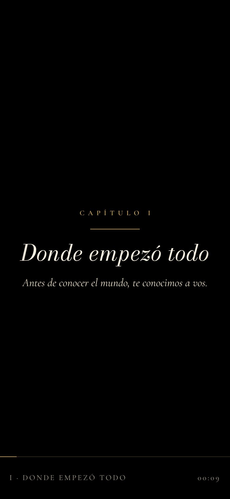
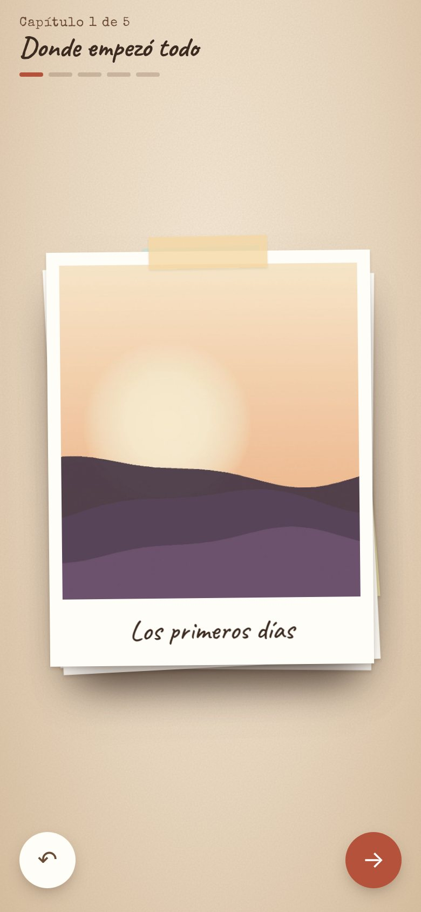

# Día de la Madre · una historia para mamá

Una página animada que cuenta la historia de tu vieja **en cinco capítulos**, con sus fotos y **la canción que vos elijas** de fondo. Arranca tranquila, va subiendo y termina con un "Feliz día, ma" que pega.

- **100 % estática:** sin servidor, sin base de datos, sin registro. Es una carpeta con un `index.html`.
- **Gratis para siempre:** se publica en GitHub Pages o como artifact de Claude.
- **Pensada primero para el celular:** iPhone (Safari) y Android (Chrome), incluidos teléfonos viejos. También se ve bien en compu.
- **Cuatro formatos para elegir**, con un solo archivo de texto para editar: `historia.js`.
- **Licencia MIT:** hacé un fork, cambiala, regalala.

👉 **Demo y comparación de formatos:** `formatos.html` (ver más abajo cómo verla publicada).

---

## Los 4 formatos

| | Formato | Cómo se vive | Ideal para |
|---|---|---|---|
|  | **Historias** `historias` | Pantalla completa como las historias de Instagram. Avanza sola al ritmo de la música; tocás para pasar y mantenés apretado para pausar. | Mamás que usan Instagram o WhatsApp. El más fácil de mirar. |
|  | **Cine** `cine` | Una película: cuenta regresiva, bandas negras, grano de cine y fotos en sepia que se llenan de color capítulo a capítulo. Termina con créditos. | El que más emociona. Mejor con buen volumen. |
|  | **Carta** `carta` | Se abre un sobre y la historia se lee bajando con el dedo, con polaroids que aparecen y frases grandes entre capítulos. | Mamás que prefieren ir a su ritmo. |
|  | **Álbum** `album` | Un álbum sobre la mesa: deslizás cada foto con el dedo. Al final, todas las fotos forman un corazón. | Interactivo y con mucho juego. |

Podés probar cualquiera sin tocar nada: agregá `?tema=cine` (o `historias`, `carta`, `album`) al final del link.

---

## Cómo hacer la tuya

### Opción A · GitHub Pages (10 minutos, gratis)

1. **Hacé un fork** de este repositorio (botón *Fork* arriba a la derecha).
2. **Subí tus fotos** a la carpeta `fotos/` (*Add file → Upload files*). Podés pisar las de ejemplo con los mismos nombres (`01.jpg`, `02.jpg`…) o usar los nombres que quieras.
3. **Editá `historia.js`** (tocá el lápiz ✏️): nombres, títulos de capítulos, frases y qué foto va en cada uno. En el campo `tema` elegís el formato.
4. **Subí la música** (opcional): un archivo `musica.mp3` al lado de `index.html`.
5. **Publicá:** *Settings → Pages → Build and deployment → Deploy from a branch → `main` / `(root)` → Save*.
6. Al minuto vas a tener tu link: `https://TU-USUARIO.github.io/diadelamadre/`. Mandalo por WhatsApp.

> Si tu repositorio es privado, GitHub Pages pide plan pago. Dejalo público: igual nadie lo encuentra si no tiene el link (la página tiene `noindex`).

### Opción B · Desde Claude, sin GitHub

Descargá `index.html` y `historia.js`, abrí un chat en [claude.ai](https://claude.ai), adjuntá esos dos archivos, tus fotos y la canción, y pegá el prompt de [`PROMPT-CLAUDE.md`](PROMPT-CLAUDE.md). Claude te arma la historia y la publica como artifact. Después tocás **Compartir** y te queda un link público.

### Opción C · Netlify o Vercel

Arrastrá la carpeta completa a [app.netlify.com/drop](https://app.netlify.com/drop) (con una cuenta gratis) o importá tu fork en Vercel. No hace falta configurar nada: no hay paso de compilación.

---

## Cómo contar una buena historia

La estructura que viene de ejemplo funciona porque **va de menor a mayor**:

| # | Capítulo | Qué fotos van | Para qué sirve |
|---|---|---|---|
| 1 | **Donde empezó todo** | Bebés, embarazo, las fotos más viejas | Ternura. Engancha. |
| 2 | **Crecer con vos** | Primer día de clases, cumpleaños, actos | Reconocimiento. |
| 3 | **Las aventuras** | Viajes, vacaciones, fotos riéndose | Alegría. Respira. |
| 4 | **Lo que no se ve** | Fotos de ella sola, cansada, cocinando, trabajando | **El golpe.** Lo que hizo sin que nadie mirara. |
| 5 | **Hoy** | Fotos recientes, todos juntos | Cierre cálido. |

Algunos consejos:

- **3 o 4 fotos por capítulo.** Con 15 o 20 fotos, la historia dura lo mismo que una canción (2 a 3 minutos).
- **El "golpe" es una sola frase**, corta, que se lea en voz alta. Es lo que aparece entre capítulo y capítulo y lo que hace llorar.
- **Pies de foto** solo en algunas. Que no sea un documento.
- Si ella ya no está, cambiá los textos a modo "en memoria": funciona igual de bien y sin confeti (el formato **Carta** es el más sereno).

## La canción

- Nombrala `musica.mp3` (o cambiá el nombre en `historia.js`).
- **`desde`:** el segundo en que arranca. Ponela unos segundos antes del estribillo y la emoción llega justo con el capítulo 4.
- **Que pese menos de 6 MB.** Un mp3 de 128 kbps de 3 minutos pesa unos 3 MB.
- **Derechos de autor:** si tu repositorio es público, la canción también queda pública. Para no tener problemas, usá música libre: [Pixabay Music](https://pixabay.com/music/), la Biblioteca de audio de YouTube o [Free Music Archive](https://freemusicarchive.org/). Si querés *esa* canción, publicalo como artifact de Claude (opción B) o en un repo privado con Netlify.
- La música nunca arranca sola: los celulares la bloquean. Por eso todas las versiones empiezan con un "tocá para abrir".

## Las fotos

- **JPG de 1600 px como máximo del lado más largo y menos de 400 KB.** Si son más grandes, pasalas por [squoosh.app](https://squoosh.app) (funciona en el navegador, no sube nada).
- Las fotos de iPhone (HEIC): exportalas como JPG o sacales captura.
- Funcionan verticales, horizontales y cuadradas. En Historias y Cine se recortan para llenar la pantalla: centrá lo importante.
- **Videos cortos:** `{ src: "videos/a.mp4", poster: "videos/a.jpg" }`. Suenan muteados para no tapar la canción.

## Que el link se vea lindo en WhatsApp

WhatsApp no ejecuta JavaScript, así que la vista previa se edita a mano en el `<head>` de `index.html`:

```html
<meta property="og:title" content="Para vos, ma 💐">
<meta property="og:image" content="https://TU-USUARIO.github.io/diadelamadre/fotos/portada.jpg">
```

`fotos/portada.jpg` tiene que ser una imagen de 1200×630 de menos de 300 KB, con la **URL completa**. WhatsApp guarda la vista previa unos días: si la cambiás, probá con `…/diadelamadre/?v=2`.

## Compatibilidad

| Dónde | Funciona | Notas |
|---|---|---|
| iPhone, Safari iOS 15+ | ✅ | Música con fundido de entrada y salida |
| iPhone viejo, iOS 12 a 14 | ✅ | Sin fundido de volumen (Safari no lo permite), el resto igual |
| Android, Chrome (incluido Android 7 a 9) | ✅ | Probado en 360 px de ancho |
| Samsung Internet | ✅ | |
| Compu: Chrome, Safari, Firefox, Edge | ✅ | Flechas del teclado y barra espaciadora |
| Celulares con poca memoria | ✅ | Detecta el modo ahorro y apaga efectos pesados |
| "Reducir movimiento" activado | ✅ | Se respeta: todo aparece sin animaciones |

Parámetros útiles en el link:

- `?tema=cine` cambia el formato.
- `?lite=1` fuerza el modo liviano.
- `?sinmusica=1` la abre sin canción.

## Estructura

```
index.html         el motor: los 4 formatos, sin dependencias (no hace falta tocarlo)
historia.js        TU historia: textos, fotos, canción y formato
fotos/             tus fotos (las que vienen son de ejemplo)
musica.mp3         tu canción (no viene incluida)
formatos.html      vitrina para comparar los 4 formatos
PROMPT-CLAUDE.md   prompt para armarla desde Claude
docs/capturas/     imágenes de este README
```

## Privacidad

La página no se indexa en buscadores, pero **cualquiera que tenga el link la puede ver**. Usá fotos que la familia esté de acuerdo en compartir, y si aparecen otras personas, preguntales.

## Licencia

[MIT](LICENSE). Usala, cambiala y regalala. Si la mejorás, mandá un *pull request*.
